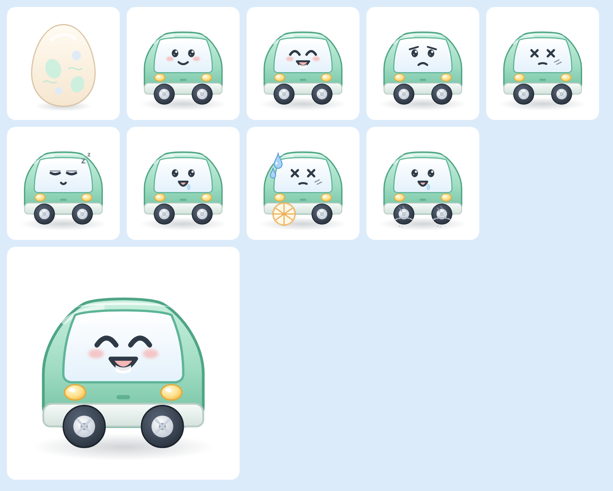

# 캐릭터 그림 v2 (코드로 그린 벡터)

외부 그림 도구 없이 SVG 코드로 그렸다. 저작권 문제 없고, 기존 캐릭터를 참고하지 않았다.
`layers.js`가 원본이고, `*.svg`는 거기서 뽑은 파일, `app/src/main/res/drawable-nodpi/*.png`는 앱에서 쓰는 1024×1024 투명 PNG다.

## 겹 구조 (모두 같은 1024×1024 캔버스, 같은 위치)

| 겹 | 파일 | 뜻 |
| --- | --- | --- |
| 몸 | `body_egg` | 부화 전 2주 |
| 몸 | `body_car` | 운전자의 차 마스코트 (가상의 둥근 소형 전기차, 앞유리가 얼굴 자리) |
| 표정 | `face_normal` `face_happy` `face_sad` `face_hurt` `face_sleepy` `face_hungry` `face_bored` `face_proud` | 기본·기쁨·시무룩·아픔·졸림·배고픔·답답(정체)·뿌듯(부드러운 운전) |
| 상태 표시 | `mark_sweat` | 냉각수 과열 경고등 |
| 상태 표시 | `mark_foot_cast` | 타이어 공기압 경고등 (왼쪽 바퀴 붕대) |
| 상태 표시 | `mark_worn_shoes` | 타이어 소모품 '주의' |

기준 좌표: 앞유리(얼굴) 중심 (512, 430), 눈 (438, 420)·(586, 420), 입 (512, 505), 바퀴 (340, 790)·(684, 790) 반지름 92.

차BTI 종족은 이 차체 위에 색·장식(다람쥐 귀·꼬리, 철새 날개 등)을 얹는 방식으로 늘린다. 실제 차종을 닮게 그리지 않는다.
새 종족·표정·상태 표시를 그릴 때 이 위치를 지키면 그대로 겹친다.

## 내 차 꾸미기 (3D 차고)

정차 중 "내 차 꾸미기" 화면은 `app/src/main/assets/garage/index.html`(three.js)을 WebView로 연다. 앞유리 얼굴은 위 표정 SVG를 그대로 쓴다.

- 원본: `garage/template.html`. 고친 뒤 `node docs/character/garage/build.js`로 assets의 index.html을 다시 만든다 (표정 SVG를 페이지 안에 넣음).
- 항목·잠김 규칙은 `domain/CarCustomization.kt`, 화면 문구는 `strings.xml`(`garage_*`)에 있다. 페이지에는 색 값과 3D 모양만 있다.
- 저장하면 표정 8종마다 3/4 앞모습 정지 그림(640px PNG)을 기기 안에 저장하고, 주행·정차 화면 캐릭터는 이 그림을 쓴다. 상태 표시(땀·붕대 등)는 캐릭터 오른쪽 위 배지로 보여 준다(#50).
- 차체는 Blender로 만든다: `docs/character/car3d/car.py`(차종별 치수·실루엣은 `bodies.py`, 색 팔레트는 `palette.py`). `export_all.sh`가 차종 7종 메시를 `app/src/main/assets/garage/meshes/<차종>.js`로 내보내고(`BLENDER` 환경변수로 blender.exe 지정), 차고 페이지는 고른 차종의 메시만 불러 그린다. 팔레트는 build.js가 같은 파일에서 읽어 페이지에 넣으므로 색을 더하거나 바꿀 때는 `palette.py` 한 곳만 고친다.
- 차 모양은 `car.py`의 스타일 "crisp"(기본값)이다. 옛 시안(cur·mono·pebble·plus·blade·facet)은 `--style`로 비교 렌더만 할 수 있게 남겨 두었다. 문·범퍼·후드 분할선은 얇은 판으로 겉면을 파내고, 창틀 몰딩·손잡이·미러·루프레일은 덧붙인 부품이다.
- 옆면 데칼은 `garage/decals/*.svg`(2048×742, 가로 = 차 길이 앞→뒤, 세로 = 바닥→지붕)이다. 파일을 더하고 `CustomSlot.DECAL`과 `strings.xml`(`garage_opt_decal_*`)에 id를 더하면 칸에 나온다.
- 차 모양을 바꾸면 `CustomizationStore.SNAPSHOT_DIR` 이름을 올려 기기에 저장된 옛 정지 그림을 쓰지 않게 한다.
- 꾸미기 전 기본 캐릭터도 3D다: `drawable-nodpi/car3d_face_*.png`(기본 차 승용 중형·딥 포레스트, 종족 장식 없음, 번호판 "에토스 1호". 밤 그림은 car3d_night_*)는 `node docs/character/garage/capture.js`로 찍는다(헤드리스 Chrome + ffmpeg, 차고 페이지의 저장 코드를 그대로 씀). `body_egg.png`(3D 알)는 그대로 둔다. 차고 모양을 바꾸면 이 그림도 다시 찍는다.
- `body_car.png`는 더 이상 화면에 나오지 않는다(기본 3D 그림이 항상 있음). 표정 PNG·SVG는 3D 앞유리 얼굴 재료로 쓴다.
- three.js 라이선스: `app/src/main/assets/garage/THREE_LICENSE.txt` (MIT).

## 고치는 법
`layers.js`를 고친 뒤 Playwright로 PNG를 다시 뽑는다 (scratch 스크립트는 PR #설명 참고). 손으로 그린 그림으로 바꿀 때는 같은 파일 이름으로 PNG만 교체하면 된다.

## 앱 아이콘
- 적응형 아이콘: 전경은 흰 선으로 그린 차 옆모습 + 눈 두 점(라인 모노그램), 배경은 어두운 회색 그라데이션(`res/drawable/ic_launcher_background.xml`). Pleos 기본 앱 아이콘(검정 바탕·흰 선) 옆에 놓여도 어색하지 않게.
- `node docs/character/icon.js`로 `ic_launcher_foreground.svg`(108×108)를 만들고, 이를 투명 PNG로 `res/mipmap-{mdpi,hdpi,xhdpi,xxhdpi,xxxhdpi}/ic_launcher_foreground.png`(108·162·216·324·432px)에 뽑는다. Chrome 헤드리스 `--default-background-color=00000000 --screenshot`으로 뽑았다.
- 그림이 바깥 원(지름 66dp 안전 영역) 밖으로 나가지 않게 둔다. 런처가 원형·둥근 사각 어느 쪽으로 잘라도 차가 다 보인다.
